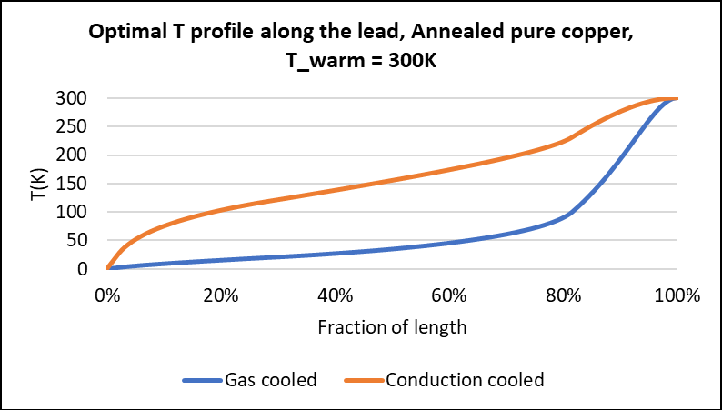

# Current lead optimisation
[← Back to main README](../README.md)

## Overview
This model calculates the optimal solution to minimise the heat leak in a current lead running from room temperature to a cryostat.
See the included PDF file for an overview of this model, including the theory, key results, and validation against published figures: [Write-up (PDF)](current_lead_optimisation.pdf)
The underlying spreadsheet model has also been uploaded: [Spreadsheet model (.xlsb)](current_lead_optimisation.xlsb)

## Results summary
The optimum heat leak / current has been calculated as 1W/kA and 47W/kA in the gas and conduction cooled cases respectively - i.e. for the same current, the heat leak is much higher in the absence of convective cooling. This matches figures published by Wilson [1] and Ballarino [2].

An example temperature profile from the model:

## Running the spreadsheet model
Requires Excel with macros enabled.

1. Main inputs to amend in the "Gas cooled" tab:
- Cold / warm end temperatures (T_1 / T_2, note gas cooled case assumes T_1 = 0)
- Efficiency of heat transfer (f) - assumed to equal 1 in write-up, adjustable in model
2. Find the optimal $\beta Z_2$ by clicking the "Find optimal beta x Z_2" button
3. Produce results for non-optimal $\beta Z_2$ in the "Gas cooled (non opt.)" tab by clicking the "Run Z_2 scalars" button
4. The optimal conduction cooled result has a closed form solution - it will be automatically calculated in the "Conduction cooled" tab
5. Produce results for non-optimal conduction cooled $\beta Z_2$ in the "Conduction cooled (non opt.)" tab by clicking the "Run Z_2 scalars" button

## References
[1] M. N. Wilson, _Superconducting Magnets_, Clarendon Press, Oxford, 1983

[2] A. Ballarino, “Current leads, links and buses”, CAS–CERN Accelerator School: Superconductivity for Accelerators, CERN-2014-005, pp. 547–558 (arXiv:1501.07166)