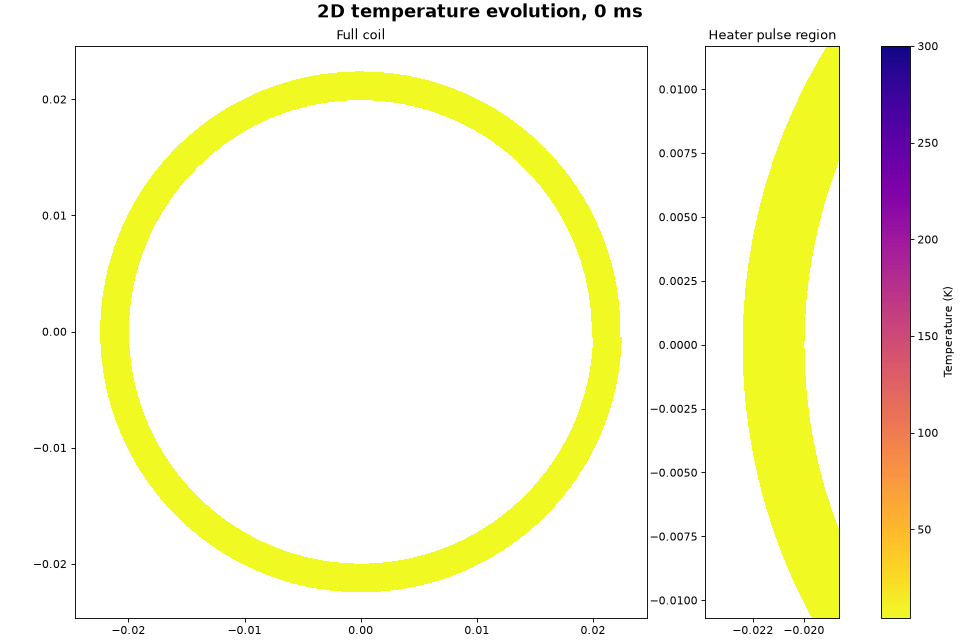
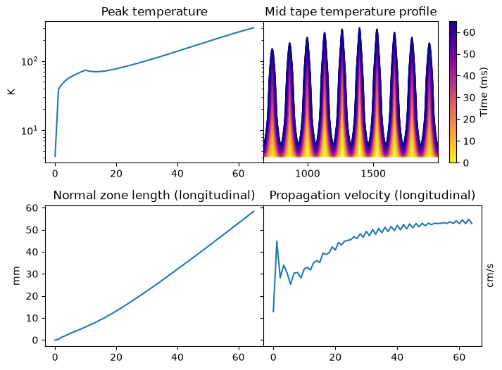
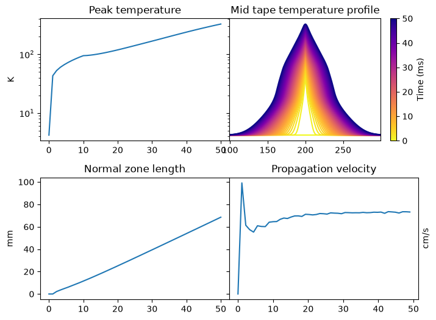

# HTS quench modelling
[← Back to main README](../README.md)

## Overview
These models have been developed to assess whether and how a quench develops in REBCO tape - first using a 1D model (along the tape), and then extending this to a 2D model (along the tape and radially).
- Run 2D quench model: [run_examples_2d.py](run_examples_2d.py)
- Function library for 2D quench model: [quench_prop_2d.py](quench_prop_2d.py)
- Run 1D quench model: [run_examples_1d.py](run_examples_1d.py)
- Function library for 1D quench model: [quench_prop_1d.py](quench_prop_1d.py)

## Results snapshot
The figures below provide an overview of the model output:

*2D model temperature evolution in the REBCO pancake coil - main result from [run_examples_2d.py](run_examples_2d.py), with 5W heater pulse in the centre turn*

*Other output from the same run, showing evolution of peak temperature, temperature profile in the central turns of the coil, normal zone length and propagation velocity along the tape*

*Equivalent output from the 1D model ([run_examples_1d.py](run_examples_1d.py)), showing the higher propagation velocity due to no radial heat diffusion*

## Validation
Aspects of the model have been tested in isolation to check for sensible behaviour, and the output has been validated against published results where possible.

### Verification
Grid convergence tested on both models by halving and doubling granularity. Note that different run setups were used for the 2 models, so they are not directly comparable as for the figures above.

**1D model**
See the following in *results* dictionary:
- Main result, fig 2.37
- Node gap x0.5
- Node gap x2

| Result | Base | Node gap x0.5 | Node gap x2 |
|---|---|---|---|
| Time to 300K (ms), 5W pulse | 44 | 44 | 43 |
| Propagation velocity (cm/s), 5W pulse | 72.8 | 73.8 | 73.0 |
| Minimum quench energy (mJ) | 3.54 | 3.57 | 3.47 |

**2D model**
See "Node spacing test" in *results* dictionary

| Result | Base | Node gap x0.5 | Node gap x2 |
|---|---|---|---|
| Time to 300K (ms), 6W pulse | 60 | 59 | 60 |
| Propagation velocity, longitudinal (cm/s), 6W pulse | 53.4 | 56.3 | 53.6 |
| Minimum quench energy (mJ) | 17.8 | 17.2 | 17.8 |

The 2D model was regression tested against the 1D model using the following setup:
- Radial conductivity switched off
- Node lengths / spacing fixed rather than changing with radius
- Coil geometry adjusted to give 1mm node spacing for consistency with 1D model
- Kapton thickness set to 0

Results for the following entries were compared in the *results* dictionaries:
- 1D model: Main result, fig 2.37
- 2D model: 1D regression

The table below summarises the comparison (all assuming 5W heater pulse, other than the MQE values), and shows that results agree to within c.2%:

| Result | 1D | 2D |
|---|---|---|
| Time to 300K (ms) | 44 | 44 |
| Propagation velocity (cm/s) | 72.8  | 74.5 |
| Minimum quench energy (mJ) | 3.54 | 3.55 |
| Detection time (ms) | 13.0 | 13.5 |
| Temperature after delay / validation / decay (K) | 184 | 184 |

An energy balance test was carried out in the 2D model to check that no energy was being created or destroyed. This is printed when running the "Energy balance test" entry in the *results* dictionary in the 2D model (the test results are not stored), and compares:
- Change in heat over all nodes (calculated as the temperature integral of specific heat, times node mass)
- Ohmic heating + heater pulse, taken as output from the solver

This showed a maximum relative error of 0.09%.

### Validation
The 1D model has been compared to various results from J. van Nugteren's thesis "High Temperature Superconductor Accelerator Magnets", primarily Fig. 2.37 and Table 5.1. Key figures were initially quite different (time to 300K, normal zone velocity, minimum quench energy), and the following adjustments were made to improve the reconciliation:
- Model: Correct dimensions. Scaling of critical surface fit applied to obtain engineering current density, to match section 5.2.1. Normal zone defined using average of current sharing and critical temperature. Disturbance applied for initial period rather than only at time 0.
- Material properties: Directly sourced thermal conductivity and resistivity, rather than relying on Wiedemann-Franz with a fixed Lorenz number (to improve modelling in the key range around current sharing / critical temperatures). Significantly reduced the RRR of the silver layer of the tape to a plausible value, based on check using 2 micron layer thickness and Drude invariant.

After applying these updates, the following results were obtained (see "Main result, fig 2.37" entry in *results* dictionary of 1D model) and compared against those from the thesis (these values and reference shown in square brackets):
- Inputs: field = 20T, angle = 84 degrees, current density = 970 A/mm^2, initial temperature = 4.2K, initial disturbance = 5W for 10ms, detection voltage = 10mV, voltage tap spacing = 1mm, total detection delay / validation / average decay time = 16.8ms
- Single front stable propagation velocity = 73cm/s [c.67cm/s once stabilised - figure 2.37]
- Time to 300K = 44ms (this ignores the dump resistor below) [45ms - p.63]
- Detection time = 13ms (at which the tape has reached 103K peak temperature)
- Estimated peak temperature after switching to dump resistor = 184K [c.220K - figure 2.44 left - single node adiabatic case, quoted as being 10-30% higher than 1D model]

The results are similar, though there are known differences in e.g. sourcing material property data - I have not used CryoComp as stated in the thesis.

The minimum quench energy for a range of current densities has been calculated and compared to Table 5.1 of the thesis, with the following results:

|             |     1D model    |          |    Table 5.1    |          |      Ratio      |          |
|-------------|:---------------:|:--------:|:---------------:|:--------:|:---------------:|:--------:|
| Current (A) | Velocity (mm/s) | MQE (mJ) | Velocity (mm/s) | MQE (mJ) | Velocity (mm/s) | MQE (mJ) |
|      50     |        0        |    216   |        14       |    234   |        0%       |    92%   |
|     150     |        78       |    74    |        76       |    85    |       103%      |    87%   |
|     250     |       159       |    47    |       140       |    57    |       113%      |    82%   |
|     400     |       277       |    24    |       259       |    32    |       107%      |    75%   |
|     600     |       605       |    11    |       500       |    17    |       121%      |    68%   |
|     1000    |       1963      |     5    |       1500      |     7    |       131%      |    63%   |

These results need further investigation, and the model becomes increasingly conservative as current increases - propagation velocity is increasingly faster than the thesis results, and minimum quench energy is lower. 

## Assumptions and limitations
- Hastelloy properties are currently estimates - minimum quench energy and propagation velocity values may shift once replaced with measured data
- Fixed current (in particular, modelling of dump resistor uses average exponential decay time, and ignores induced voltage)
- Fixed and uniform field, and field angle
- Adiabatic
- Cooling ignored
- Only an insulated coil has been considered
- Modelled using discrete nodes

## Running the model
Open either the [run_examples_2d.py](run_examples_2d.py) or [run_examples_1d.py](run_examples_1d.py) files - there are example runs contained in these, stored in the *results* variables.
These have been setup as follows:
- Specify a set of *base_core_...* parameters (needed for the solver to run) and *base_other_...* parameters (used to calculate detection results)
- Pass these to the *run_param_grid* function, along with any changes to be made for each individual run (by using *change_core=dict* or *change_other=dict* inside the *run_param_grid* function)
    - Changes to parameters can be single values, list of values, or numpy arrays of values - *run_param_grid* will then run all combinations of these changes to produce a DataFrame of results

Sensitivities (used to setup tornado plots) have been setup in the 1D file - these are specified slightly differently:
- Specify a set of parameters to sensitivity test (*sens_params* variable)
- Specify the relative sensitivity to apply (*sens_pct*)
- Run each parameter sensitivity as a separate run, and store all results in a dictionary which can then be passed to the *tornado_plot* function

## References
- J. van Nugteren, High Temperature Superconductor Accelerator Magnets, PhD thesis, University of Twente, 2016. Used for the overall modelling approach, the critical-surface fit (Table A.3) and its scaling (section 5.2.1), and the benchmark results (Figs. 2.37 and 2.39, Table 5.1, and the detection timeline on pp. 65–68).
- M. N. Wilson, Superconducting Magnets, Oxford University Press, 1983. Used for normal-zone propagation theory, including transverse propagation, and the hot-spot and protection framework.
- P. Virtanen et al., “SciPy 1.0: Fundamental Algorithms for Scientific Computing in Python”, Nature Methods 17, 261–272 (2020). Used for solve_ivp.
- [materials properties sources](data/)

